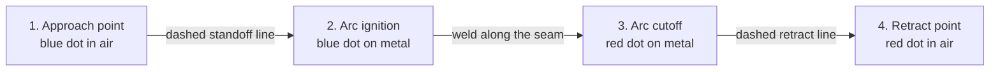

# Armatrix — Autonomous Robotic Weld Seam Planner

An industrial CAD/CAM web platform engineered for **autonomous robotic weld seam planning**, tailored specifically to the operational constraints of **Armatrix's hyper-redundant continuum snake-arm robots**.

Built by **Sreeja Das**.

---

## 1. Project Overview & Operational Context

Armatrix designs snake-like robotic manipulators (3–5 meter reach, 50–150 mm cross-section, 20+ degrees of freedom) engineered to enter ultra-confined, hazardous industrial environments (ship hull double bottoms, boiler tubes, pipelines, and nuclear heat exchangers) where human welders cannot physically fit.

Before an autonomous snake arm can weld inside a complex cavity, an engineer must:
1. Ingest the structural CAD geometry (`.stl`).
2. Identify seam trajectories and attack angles (surface normals).
3. Specify welding parameters (MIG/TIG/Laser, travel speed, amperage, voltage, wire feed, shielding gas).
4. Sequence seams to minimize thermal heat distortion and prevent internal arm self-collisions.
5. Export a deterministic, machine-readable **Weld Job JSON** consumed by the robot's inverse kinematics (IK) motion controller.

This application provides an end-to-end, browser-based workflow fulfilling these operational requirements.

---

## 2. Core Features Built

### 1. Robust 3D CAD Ingestion (.STL)
* Supports both **Binary and ASCII STL** formats.
* Custom file upload via the header's **Upload STL** file picker.
* **Pre-bundled Industrial Benchmark Models** (Structural L-Bracket, Pipe T-Joint, Box Flange) for immediate out-of-the-box evaluation without needing external files.
* Automatic geometric centering, ground-plane alignment, vertex normal re-computation, and bounding box telemetry (`W × H × D mm`, triangle count).
* **Orientation control**: STL has no notion of "up", so Z-up exports can arrive lying on their side. Uploaded parts can be turned in 90° steps about X or Z (Shift+click turns the other way); the part re-seats on the table and the rotation is recorded in the export.
* **Mesh integrity check**: vertices are welded by position and every edge is counted. A part is marked **Watertight** when every edge is shared by two triangles, or **Open mesh** (with the open-edge count) when the surface has holes that could make crease detection unreliable. Edges shared by more than two triangles, where separate bodies touch in a welded assembly, are reported but tolerated.

### 2. Dual-Mode Seam Planning
* **Autonomous Crease Detection**:
  * Algorithmic dihedral angle crease detection analyzing adjacent triangle face normals across the mesh topology.
  * Identifies 90° fillet and acute weld joints with automatic surface normal bisector calculation.
  * **Pipe T-joint saddle**: generated from the analytic branch/header intersection curve `y(θ) = 36 + √(25² − z²)` as 12 segments of 30°. Every vertex lies on a facet edge of the branch mesh, and each segment gets its own torch normal: the bisector of the branch's outward radial and the header's outward surface normal.
* **Air-gap substrate validation**: seams that bridge open space are flagged non-manufacturable while drawing, in the seam list and in the export (`air_gap_detected`).
* **Interactive Point-to-Point Snapping**:
  * Precision raycasting directly on the 3D mesh surface.
  * Click Point 1 (Start) → Click Point 2 (End) to create calibrated weld bead paths.
  * Automatic surface normal derivation at the hit face to establish the torch approach vector.

### 3. Comprehensive Welding Parameter Engineering
* **Process Selection**: MIG (GMAW), TIG (GTAW), and Laser Welding.
* **Joint Geometry**: Fillet, Butt, Lap, Corner, and Edge joints.
* **Electrical & Motion Controls**:
  * Travel Speed (`mm/s`)
  * Welding Current (`Amperes`)
  * Arc Voltage (`Volts`)
  * Wire Feed Speed (`m/min`)
  * Shielding Gas Flow (`L/min`)
* **Torch Attack Angles**: Adjustable Lead Angle and Tilt Angle relative to the local surface normal vector.
* **Standoff Clearance**: Configurable Approach Height and Retract Height in millimeters.

### 4. Thermal Distortion Management & Sequencing
* Reorder seam execution order (Move Up / Move Down) to alternate weld passes across parts and balance thermal expansion.
* **Interpass Cooling Delay**: Configurable cooling duration between seams to prevent thin metal buckling.
* Reverse travel direction (swap Start ⇄ End coordinates) with a single click.

### 5. High-Fidelity 3D Simulation Engine & 4-Waypoint Trajectory Pipeline
* Binzel-style robotic gooseneck MIG torch (chrome gas nozzle, copper contact tip and wire stick-out at the arc point), scaled about 1:3 to fit the benchmark parts' gusset bays.
* **The 4-Stage Collision-Free Trajectory Pipeline**:



```
[1. Approach Point]        [2. Arc Ignition]              [3. Arc Cutoff]         [4. Retract Point]
  (Blue Dot in Air)          (Blue Dot on Metal)            (Red Dot on Metal)       (Red Dot in Air)
         ○ -------------------------> ● =========================> ● -------------------------> ○
            Dashed Standoff Line        Active Seam Arc Travel        Dashed Retract Line
```

* Animated simulation executing:
  1. **Rapid Traverse**: Moves from previous retract point to next approach point at 120 mm/s.
  2. **Safe Approach**: Descends along the surface normal vector to touch off at the seam start point.
  3. **Active Arc Welding**: Travels along the seam depositing a metallic bead. Arc lighting is a blue-white arc column plus a warm molten-pool light, with smoothed flicker, arc-strike ramp-up and crater fade-out. Ballistic spatter particles fly off the arc and fall under gravity (heavy for MIG, light for laser, almost none for TIG).
  4. **Retract**: Pulls outward along the surface normal to safe clearance height.
* Simulation timeline HUD with Play/Pause/Reset, seam stepping, speed multipliers (1×, 2×, 5×), and phase status indicators.
* **Non-manufacturable seams are never welded**: *Run All* skips air-gap seams and shows a notice. Simulating one on its own performs an arc-off **dry run** (no bead, no arc, never marked welded) so the user can see the invalid path.

### 6. Armatrix Brand & Industrial Ergonomics
* Armatrix brand system (from armatrix.com): Bright Discovery orange `#E97F01` used only as a signal, dark forest and revolution-green surfaces, **Onest** for headings and labels, **42dot Sans** for body text.
* CAD HUD overlays, coordinate readouts, camera view presets (ISO, Top, Front, Side), and display layers (fixture table, ghost X-ray, approach vectors, facet wireframe, bounds).
* **Reach check** computed from the loaded part: its bounding-box diagonal against the 3500 mm snake-arm envelope (*Within reach* / *Exceeds reach*).
* Collapsible side panels with edge tabs. When the parameters panel is collapsed, a translucent *seam in focus* card keeps the selected seam's settings visible.

### 7. Planner Controls
The keyboard button next to Export shows these in the app. A short guided tour runs on the first visit and can be replayed from there.

The planner also runs on tablets for viewing, auto-detection, parameters, simulation and export. Manual click-to-weld needs a mouse, because drawing a seam relies on precise clicks and right-drag orbiting while a start point is anchored.

| Input | Action |
| :--- | :--- |
| Left or right drag | Orbit the camera. Right drag also works while drawing and keeps the anchored start point. |
| Scroll | Zoom |
| Click a seam | Select it and focus the camera on it |
| Double-click a seam name | Rename it |
| `Ctrl` + `Z` | Undo the last seam change |
| `Delete` | Delete the selected seam |
| `Esc` | Drop the anchored point, leave click-to-weld, or deselect |
| Arrow keys | Orbit the view in 15° steps, including while drawing a seam |
| `+` / `-` | Zoom in and out |
| `F` | Frame the selected seam |
| `Home` | Reset to the ISO view |
| `Space` | Play or pause the simulation |

---

## 3. Architecture & Key Design Decisions

```
armatrix-weld-seam-planner/
├── src/
│   ├── app/
│   │   ├── globals.css         # Tailwind CSS styling & custom CAD scrollbars
│   │   ├── layout.tsx          # App shell, metadata, and dark theme
│   │   ├── page.tsx            # Launch page
│   │   ├── planner/page.tsx    # Planner workbench layout & keyboard shortcuts
│   │   └── docs/page.tsx       # Documentation page
│   ├── components/
│   │   ├── viewport/
│   │   │   └── ViewportCanvas.tsx # Three.js WebGL scene, OrbitControls, Raycaster, Torch 3D
│   │   └── panels/
│   │       ├── Header.tsx      # Benchmarks, STL upload, Camera presets, View toggles
│   │       ├── SidebarLeft.tsx # Part telemetry, Seam sequence list, Auto-detect
│   │       ├── SidebarRight.tsx# Welding parameters, Torch angles, Armatrix Kinematics
│   │       ├── SimulationHUD.tsx# Playback transport, Phase badges, Speed controls
│   │       └── ExportModal.tsx # Formatted JSON viewer & interactive schema documentation
│   ├── store/
│   │   └── useWeldStore.ts     # Central Zustand reactive state & JSON export generator
│   ├── types/
│   │   └── weld.ts             # Domain models (WeldSeam, Parameters, RobotExport)
│   └── utils/
│       ├── seamDetector.ts     # Dihedral angle crease detection algorithm
│       ├── substrateValidator.ts # Air-gap (no substrate) detection
│       ├── meshIntegrity.ts    # Watertight / open-edge mesh check
│       └── reach.ts            # Part vs 3500 mm reach envelope
└── public/
    └── models/                 # Pre-generated STL benchmark parts (bracket, pipe T-joint, box flange)
```

### Why Next.js 16 + TypeScript?
* **Zero-Friction Cloud Deployment**: One-command instant deployment to Vercel or any Node/Docker environment fulfilling the assignment's public live URL requirement.
* **Strict Type Safety**: Welding vectors, normal orientations, and export JSON schemas are strictly validated at compile time, eliminating runtime undefined errors in the 3D loop.

### Why Direct Three.js with React Wrappers?
* Direct Three.js WebGL rendering inside a reactive `ViewportCanvas` container guarantees 60+ FPS performance even when handling complex STL meshes with tens of thousands of triangles.
* Decouples the 60 FPS animation loop from React's component re-render tree, preventing UI stuttering during high-frequency raycasting and torch motion.

### Why Zustand for State Management?
* Ultra-lightweight and operates seamlessly outside the React render cycle. Three.js raycasting handlers can read and write state without causing unnecessary component thrashing.

---

## 4. Exported Weld Job JSON Schema

The exported JSON is formatted specifically for ingestion by robotic motion controllers and inverse kinematics (IK) solvers:

```json
{
  "schema_version": "1.4.0",
  "generator": "Armatrix Autonomous Seam Planner v1.0",
  "job_id": "ARMX-WELD-MH82J9X",
  "created_at": "2026-10-30T14:15:00.000Z",
  "part": {
    "filename": "Structural L-Bracket",
    "units": "mm",
    "bounding_dimensions_mm": {
      "x": 100.0,
      "y": 82.0,
      "z": 60.0
    },
    "coordinate_frame": {
      "handedness": "right-handed",
      "up_axis": "+Y",
      "origin": "Part bounding-box centre in X and Z, at the part's lowest point in Y (the fixture table surface)"
    },
    "mesh_integrity": { "watertight": true, "open_edges": 0 }
  },
  "robot_controller_profile": {
    "kinematics": "Armatrix-Continuum-Snake-Arm",
    "reach_envelope_max_mm": 3500,
    "rapid_traverse_speed_mm_s": 120,
    "safe_plane_z_clearance_mm": 40,
    "tool_effector": {
      "model": "Generic-Robotic-Weld-Torch",
      "nozzle_configuration": "Narrow-Bottleneck-Deep-Access"
    }
  },
  "job_summary": {
    "total_seams": 3,
    "executable_seams": 3,
    "skipped_seam_ids": [],
    "total_weld_length_mm": 218.4,
    "estimated_active_weld_time_sec": 18.2,
    "estimated_traverse_time_sec": 2.4,
    "estimated_cooling_delays_sec": 15.0,
    "total_cycle_time_sec": 35.6
  },
  "seams": [
    {
      "seam_id": "SEAM-01",
      "name": "Seam 1 (90.0 mm)",
      "sequence_order": 1,
      "process": "MIG",
      "joint_type": "FILLET",
      "length_mm": 90.0,
      "start_coordinate": [-45.0, 12.0, -18.0],
      "end_coordinate": [45.0, 12.0, -18.0],
      "surface_normal": [0.0, 0.707, 0.707],
      "approach_point": [-45.0, 29.675, -0.325],
      "retract_point": [45.0, 33.21, 3.21],
      "torch_axis": [0.0, 0.7071, 0.7071],
      "travel_direction": [1.0, 0.0, 0.0],
      "executable": true,
      "torch_orientation": {
        "lead_angle_deg": 10.0,
        "tilt_angle_deg": 45.0,
        "nozzle_type": "narrow"
      },
      "weld_parameters": {
        "travel_speed_mm_s": 12.0,
        "current_amps": 180,
        "voltage_volts": 24.0,
        "wire_feed_m_min": 6.5,
        "shielding_gas_l_min": 14.0,
        "interpass_delay_sec": 5.0,
        "wire_diameter_mm": 1.2
      },
      "air_gap_detected": false,
      "waypoints": [
        [-45.0, 12.0, -18.0],
        [-40.0, 12.0, -18.0],
        [-35.0, 12.0, -18.0],
        "..."
      ]
    }
  ]
}
```

### Field Definitions:

| Field | Type | Description |
| :--- | :--- | :--- |
| `schema_version` | String | Version identifier for backward compatibility with robot firmware. |
| `generator` / `created_at` | String | Tool that produced the job and ISO-8601 creation timestamp. |
| `job_id` | String | Unique tracking ID generated for the manufacturing session. |
| `part.bounding_dimensions_mm` | Object | Overall `X, Y, Z` envelope to verify part fits inside the fixture. |
| `part.filename` / `part.units` | String | Source part name and unit system (always `mm`). |
| `part.import_rotation_deg` | Object | Quarter-turn rotation (`x`, `z` in degrees) applied to an uploaded STL to stand it upright before planning. All coordinates are after this rotation. |
| `part.coordinate_frame` | Object | Right-handed, `+Y` up; origin at the part bounding-box centre in X/Z on the table surface (lowest Y). Every coordinate in the file is in this frame. |
| `part.mesh_integrity` | Object \| null | `watertight` flag and `open_edges` count from the STL edge-manifold check. |
| `robot_controller_profile` | Object | Continuum snake-arm parameters (3500mm reach, rapid speed, safe clearance plane). |
| `robot_controller_profile.tool_effector` | Object | Torch model and nozzle configuration the job was planned for. The model is a generic stand-in; the arm's real end-effector geometry and tool-centre-point offset belong to the controller's tool configuration. |
| `job_summary` | Object | `total_seams`, `executable_seams` and `skipped_seam_ids`, then, for executable seams only: weld length, arc-on time, rapid traverse time (retract → next approach), interpass cooling (between passes, none after the final pass) and total cycle time. |
| `seam_id` & `sequence_order` | String / Int | Unique identifier and execution order index for thermal distortion management. |
| `name` / `length_mm` | String / Float | User-editable seam name and straight-line seam length in mm. |
| `process` | Enum | `MIG`, `TIG`, or `LASER`. Directs the power source mode and wire feeder. |
| `joint_type` | Enum | Joint classification (`FILLET`, `BUTT`, `LAP`, etc.) for adaptive weaving. |
| `start_coordinate` / `end_coordinate` | Float[3] | 3D Cartesian coordinates in the part coordinate frame (`[X, Y, Z]` mm). |
| `surface_normal` | Float[3] | Unit vector pointing outward from the joint; dictates the torch bisector angle. |
| `approach_point` | Float[3] | Safe 3D coordinate at `start_coordinate + torch_axis * approach_distance`, where `torch_axis` is the surface normal rotated by the joint work-angle offset (about the seam) and the lead angle (along travel), exactly as simulated. The snake arm positions here prior to striking the arc to prevent collisions. |
| `retract_point` | Float[3] | Safe 3D coordinate at `end_coordinate + torch_axis * retract_distance` (same torch axis). The torch pulls out here after extinguishing the arc before traversing. |
| `torch_axis` | Float[3] | Unit tool-axis vector (from the weld point up the torch body) after tilt and lead are applied: the exact orientation the simulator uses, so the controller does not need to re-derive it from angles. |
| `travel_direction` | Float[3] | Unit vector from `start_coordinate` to `end_coordinate`. Together with `torch_axis` it fully defines the tool frame. |
| `executable` | Boolean | `false` for non-manufacturable seams; the controller must not run them. |
| `torch_orientation` | Object | Lead (push/drag) and tilt angles in degrees relative to the seam vector, plus `nozzle_type` (`conical`, `narrow` or `laser`). |
| `weld_parameters` | Object | Travel speed, amperage, voltage, wire feed speed, shielding gas flow, interpass cooling time and wire diameter (`wire_diameter_mm`, AWS ER70S-6). |
| `air_gap_detected` | Boolean | `true` when the seam bridges open space with no metal underneath. The controller must reject these seams; the planner never welds them in simulation. |
| `waypoints` | Float[][3] | Discretized 5mm trajectory spline coordinates for direct input to the inverse kinematics solver. |

---

## 5. Local Setup & Execution Guide

### Prerequisites
* **Node.js**: v18.0 or higher (Tested on Node v22)
* **Package Manager**: `pnpm` (recommended), `npm`, or `yarn`

### Steps
```bash
# 1. Clone repository
git clone https://github.com/sparrowdex/armatrix_weld_seam_planner.git
cd armatrix_weld_seam_planner

# 2. Install dependencies
pnpm install

# 3. Generate benchmark 3D STL models (if needed)
node scripts/generate_sample_stls.js

# 4. Start local development server
pnpm run dev

# 5. Open in browser
# Navigate to http://localhost:3000
```

### Production Build
```bash
# Build optimized production bundle
pnpm run build

# Start production server
pnpm run start
```

---

## 6. How We Evaluated Operational Edge Cases

1. **Confined Space Approach/Retract**: Traditional open-gantry Cartesian robots can approach a part from any arbitrary direction. Inside a pipe or narrow compartment, Armatrix's snake arm cannot do this. Every seam in our planner generates **explicit normal approach and retract vectors** ensuring the robot enters and leaves safely without scraping adjacent walls.
2. **Thermal Distortion Optimization**: Thin structural plates warp if adjacent welds are performed continuously. Our planner provides instant sequence reordering and configurable interpass cooling delays.
3. **Deterministic Waypoint Discretization**: Industrial robot controllers often experience kinematic singularities if given only sparse endpoints. We compute interpolated 5mm waypoint splines so the trajectory planner maintains constant travel speed along the seam.

### Robustness Test Set

Beyond the three benchmark parts, the planner was exercised with deliberately awkward uploads. They live in [`test-stls/`](test-stls/) and can be uploaded with **Upload STL**; `python scripts/generate_test_stls.py` regenerates all of them, including the 20 MB dense sphere that is not committed.

| File | What it tests | Result |
| :--- | :--- | :--- |
| `01_cube_corner_ascii.stl` | ASCII STL in unit-less coordinates (loads as 1.7 mm) | Loads and frames; amber units hint; auto-detect reports no joints (single solid) |
| `02_bracket_binary.stl` | Binary STL, two separate bodies touching | Watertight; auto-detect finds the contact joints (root line where the upright meets the base) |
| `03_open_tray_no_lid.stl` | Open surface with holes | Amber **Open mesh** badge with the open-edge count |
| `04_flat_plate.stl` | Nothing to weld | "No weld joints found" message |
| `05_tiny_4mm_cube.stl` | Very small part | Camera, snapping and drawing aids scale to the part; torch and bead stay real size |
| `06_huge_5m_beam.stl` | Part beyond the arm's reach | **Exceeds reach**; fixture table and grid grow; drawing aids scale up |
| `07_bracket_in_metres.stl` | Wrong export units | Units hint (part is 0.17 mm across) |
| `08_bracket_z_up.stl` | Z-up export lying on its side | **Shift+click X 90°** stands it up; detection runs on the rotated part; rotation recorded in the export |
| `09_sphere_curved.stl` | Curved single solid | No joints; a straight seam across the surface cuts through the part and is flagged as an air gap (dry run, no bead) |
| `10_dense_sphere_400k.stl` *(generated)* | 400k triangles, 20 MB | Part appears immediately; outline and mesh check follow (about 0.6 s); wireframe built on demand |
| `11_not_really_an_stl.stl` | Text file renamed to `.stl` | In-app "couldn't be read as an STL" message; app keeps running |
| `12_empty.stl` | Empty file | Same in-app message |

---

## 7. Future Work

Deliberately left out of this version to stay within the brief, but natural next steps:

* **Accounts and saved projects**: sign-in, a project library per user, and saved planning sessions (part, seams, parameters) so work can be resumed or shared with a cell operator.
* **Job versioning**: keep a history of exported weld jobs per part, with diffs between versions, so a controller can always be traced back to the plan it ran.
* **Units and orientation on import**: detect or ask for units (mm, m, inch) and up axis (Z-up vs Y-up) when an STL is uploaded.
* **Curved seam paths**: true polyline/spline seams instead of chained straight segments, for saddles and contoured joints.
* **Arm-aware reach**: place the snake-arm base and entry point, then check reach and approach clearance per seam rather than against the part envelope.
* **Collision checking for the whole torch path**, including approach, retract and traverse moves, not just the seam itself.
* **Direct controller hand-off**: push a job to the arm controller (for example over a ROS 2 action) instead of downloading a file.

---

## License

© 2026 Sreeja Das. All rights reserved.

This repository is shared for evaluation purposes. No part of the code may be copied, modified, or redistributed without written permission from the author.
