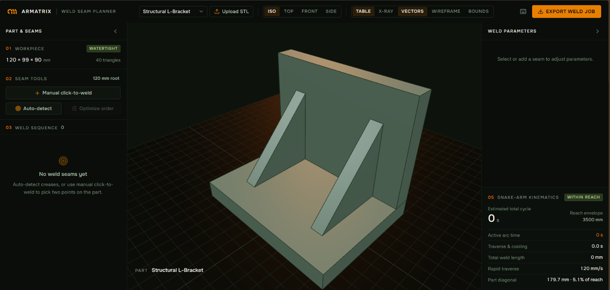
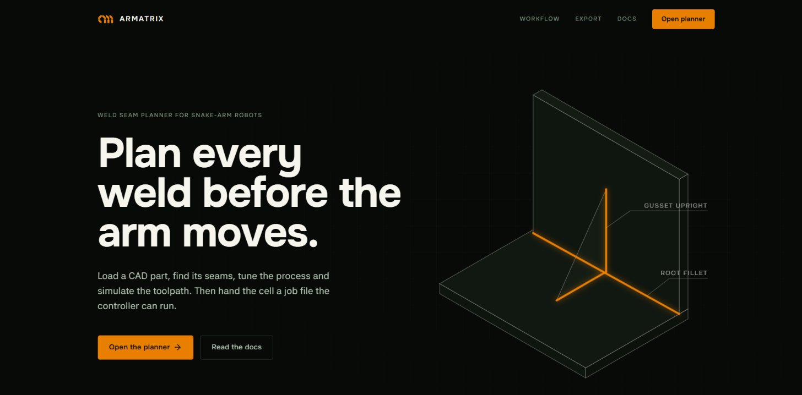
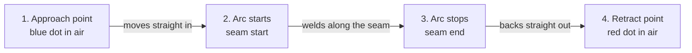

# Armatrix — Weld Seam Planner

A browser-based tool for planning robotic welds on CAD parts, built around **Armatrix's snake-arm robots**. You load a part, mark the seams to weld, set the welding process, watch a simulated torch carry out the job, and export a job file for the robot's controller.

Built by **Sreeja Das**.

| | |
| :--- | :--- |
| **Live planner** | [armatrix-weld-seam-planner-gules.vercel.app](https://armatrix-weld-seam-planner-gules.vercel.app) (runs in the browser, no install) |
| **Demo video** | [Watch the full workflow walkthrough](https://drive.google.com/file/d/1jQg1bqgj1vfCsZEpdHGzcx0194EBMaKV/view?usp=sharing): load, detect, configure, simulate, export |



---

## 1. Project Overview

Armatrix builds snake-like robotic arms (3–5 m reach, 50–150 mm cross-section, real-time 24-DoF control) that enter confined, hazardous structures through existing manholes, nozzles and access ports, for shipbuilding and marine, oil and gas, and aerospace work. The arms are externally actuated, with no motors or electronics inside the arm body, so they can work in explosive, flooded, irradiated and extreme-temperature environments where people cannot safely weld. This planner uses the 3500 mm reach from the assignment brief.

Before a robot can weld a part, someone has to:
1. Load the part's CAD geometry (`.stl`).
2. Decide where the seams are and which way the torch should point at each one.
3. Choose the welding settings (process, travel speed, current, voltage, wire feed, shielding gas).
4. Put the seams in a sensible order, so heat is spread out and the part does not warp.
5. Hand the robot's controller a precise, machine-readable job file.

This app covers all five steps in one place, in the browser.



---

## 2. Features

### 1. Loading parts (STL)
* Reads both **binary and ASCII** STL files, from the **Upload STL** button.
* Three **built-in benchmark parts** (Structural L-Bracket, Pipe T-Joint, Box Flange) so the app can be tried without any files.
* Every part is centred, placed on the fixture table and measured (`W × H × D mm` and triangle count).
* **Orientation**: STL files do not record which way is up, so parts exported from tools that use Z as up can arrive lying on their side. Uploaded parts can be turned in 90° steps about X or Z (Shift+click turns the other way). The rotation is recorded in the export.
* **Watertight check**: the app checks whether the part's surface is fully closed. A closed part shows **Watertight**; a part with holes shows **Open mesh**, because holes can confuse seam detection.
* **Units hint**: a part smaller than 5 mm or larger than 50 m across is probably in the wrong units (for example metres instead of millimetres), and the app says so.

### 2. Defining seams
* **Auto-detect** looks for real weld joints on uploaded parts:
  * **inside corners**, where two faces meet like the corner of a box seen from inside (a classic fillet weld), and
  * **contact lines**, where one part sits on another, such as an upright plate standing on a base plate.
  * Plain outside edges of a single solid piece are not reported, because there is nothing to join. Edges resting on the table are skipped, because the torch cannot reach underneath a part sitting on a table.
* For the three **benchmark parts**, auto-detect uses seams placed by hand for those exact shapes, with clearance from walls already worked out. The pipe T-joint seam follows the real curve where the two pipes meet, as 12 short segments.
* **Manual click-to-weld**: click a start point and an end point on the part. The cursor snaps to nearby corners, existing seam ends and straight lines along X, Y or Z.
* **Air-gap check**: a seam that crosses open air (no metal underneath part of its path) is flagged as not weldable, while drawing, in the seam list and in the export.

### 3. Welding settings
* **Process**: MIG, TIG or laser.
* **Joint type**: fillet, butt, lap, corner or edge.
* **Settings**: travel speed (`mm/s`), current (`A`), voltage (`V`), wire feed speed (`m/min`), shielding gas flow (`L/min`) and wire diameter.
* **Torch angles**: tilt (sideways across the seam) and lead (forwards or backwards along the seam).
* **Approach and retract distances**: how far back the torch starts before moving in, and how far it backs out afterwards.

### 4. Seam order and heat
* Move seams up or down the list, or reverse a seam's direction, with one click.
* **Optimize order** alternates seams from side to side so heat is spread across the part.
* **Interpass cooling**: a pause between seams so the metal can cool before the next weld.

### 5. Simulation
* A simplified robotic MIG torch (gooseneck, gas nozzle, contact tip and wire). It is modelled smaller than a full-size torch, about a third, so it fits between the benchmark bracket's gussets.
* Each seam is welded in four moves:



* Between seams the torch makes a fast move at 120 mm/s, from one seam's retract point to the next seam's approach point.
* Approach and retract follow the torch's own direction, so the torch moves in and out in a straight line instead of sliding along the part.
* While welding, the bead appears behind the torch, glows and cools, sparks fly off the arc (most for MIG, few for laser, almost none for TIG) and the plate darkens slightly near the weld before fading back.
* Controls for play, pause, reset, stepping between seams and 1×, 2× or 5× speed. Optional arc sound, muted by default.
* **Seams that cannot be welded are never faked**: Run All skips air-gap seams and says so, and simulating one on its own does a "dry run" with the arc off and no bead.

### 6. Reach, cycle time and display
* **Reach check**: the part's size (corner to corner) is compared with the 3500 mm reach, showing *Within reach* or *Exceeds reach*.
* **Cycle time**: arc time (seam length ÷ travel speed) + travel time between seams at 120 mm/s + cooling pauses.
* Camera presets (ISO, Top, Front, Side) and display layers: fixture table, X-ray (see-through part), approach and retract vectors, wireframe and bounding box.
* On-screen drawing aids (markers, seam lines, arrows, snapping) scale with the part, so very small and very large parts stay usable. The torch, bead and sparks always stay real size.
* Collapsible side panels. When the parameters panel is collapsed, a small *seam in focus* card keeps the selected seam's settings visible.
* Brand style taken from armatrix.com: orange `#E97F01` as the highlight colour, **Onest** for headings and labels, **42dot Sans** for body text.

### 7. Controls
The keyboard button next to Export shows these in the app. A short guided tour runs on the first visit and can be replayed from there.

The planner also works on tablets for viewing, auto-detect, settings, simulation and export. Manual click-to-weld needs a mouse, because drawing a seam uses precise clicks and right-drag to rotate the view.

| Input | Action |
| :--- | :--- |
| Left or right drag | Rotate the view. Right drag also works while drawing and keeps the start point. |
| Scroll | Zoom |
| Click a seam | Select it and focus the camera on it |
| Double-click a seam name | Rename it |
| `Ctrl` + `Z` | Undo the last seam change |
| `Delete` | Delete the selected seam |
| `Esc` | Drop the start point, leave click-to-weld, or deselect |
| Arrow keys | Rotate the view in 15° steps, including while drawing a seam |
| `+` / `-` | Zoom in and out |
| `F` | Frame the selected seam |
| `Home` | Reset to the ISO view |
| `Space` | Play or pause the simulation |

---

## 3. How It Is Built

```
armatrix-weld-seam-planner/
├── src/
│   ├── app/
│   │   ├── page.tsx              # Landing page
│   │   ├── planner/page.tsx      # Planner layout and keyboard shortcuts
│   │   ├── docs/page.tsx         # Job file documentation page
│   │   ├── layout.tsx            # App shell and page metadata
│   │   └── globals.css           # Styles and shared UI building blocks
│   ├── components/
│   │   ├── viewport/
│   │   │   ├── ViewportCanvas.tsx    # 3D scene: part, seams, torch, simulation
│   │   │   ├── ViewportOverlays.tsx  # On-screen labels, seam-in-focus card, banners
│   │   │   └── torchModel.ts         # 3D model of the torch
│   │   └── panels/
│   │       ├── Header.tsx            # Part picker, upload, view presets, display layers
│   │       ├── SidebarLeft.tsx       # Part info, seam tools, seam list
│   │       ├── SidebarRight.tsx      # Weld settings, torch angles, reach and cycle time
│   │       ├── SimulationHUD.tsx     # Play, pause, speed and phase
│   │       ├── ExportModal.tsx       # JSON viewer with copy and download
│   │       ├── ShortcutsPanel.tsx    # Controls reference
│   │       └── OnboardingTour.tsx    # First-visit guided tour
│   ├── store/
│   │   └── useWeldStore.ts       # App state and the JSON export
│   ├── types/
│   │   └── weld.ts               # Data types (seams, settings, export)
│   └── utils/
│       ├── seamDetector.ts       # Auto-detect: inside corners and contact lines
│       ├── substrateValidator.ts # Air-gap check
│       ├── meshIntegrity.ts      # Watertight check
│       ├── snapping.ts           # Snapping while drawing seams
│       ├── torchKinematics.ts    # Torch direction from tilt and lead
│       ├── reach.ts              # Reach check
│       ├── partScale.ts          # Size of drawing aids relative to the part
│       ├── partOrientation.ts    # 90° rotation of uploaded parts
│       ├── weldVisuals.ts        # Bead shape, glow and heat tint
│       ├── arcAudio.ts           # Arc sound
│       └── keyboard.ts           # When hotkeys should be ignored
├── public/models/                # Benchmark parts (bracket, pipe T-joint, box flange)
├── test-stls/                    # Awkward files used for testing (see section 6)
└── scripts/                      # Generators for the benchmark and test STLs
```

### Why Next.js and TypeScript?
* **Easy to host**: deploys to Vercel straight from GitHub, which gives the public live link the brief asks for.
* **Types catch mistakes early**: positions, directions and the export format are all typed, so many mistakes show up while building instead of at runtime.

### Why Three.js directly?
* Three.js draws the 3D scene in the browser with WebGL. The animation runs in its own loop, separate from React, so the simulation stays smooth (typically 60 frames per second) while the panels update.
* The scene only redraws while something is changing, so the app uses almost no graphics power when idle.

### Why Zustand for state?
* A small state library that both the React panels and the 3D scene can read and update directly, without slowing each other down.

---

## 4. Exported Weld Job JSON

The export is a single JSON file that describes the whole job for the robot's controller:

```json
{
  "schema_version": "1.4.0",
  "generator": "Armatrix Weld Seam Planner 1.9.0",
  "job_id": "ARMX-WELD-MH82J9X",
  "created_at": "2026-10-30T14:15:00.000Z",
  "part": {
    "filename": "Structural L-Bracket",
    "units": "mm",
    "bounding_dimensions_mm": {
      "x": 100.0,
      "y": 82.0,
      "z": 60.0
    },
    "import_rotation_deg": { "x": 0, "z": 0 },
    "coordinate_frame": {
      "handedness": "right-handed",
      "up_axis": "+Y",
      "origin": "Part bounding-box centre in X and Z, at the part's lowest point in Y (the fixture table surface)"
    },
    "mesh_integrity": { "watertight": true, "open_edges": 0 }
  },
  "robot_controller_profile": {
    "kinematics": "Armatrix-Snake-Arm",
    "reach_envelope_max_mm": 3500,
    "rapid_traverse_speed_mm_s": 120,
    "safe_plane_z_clearance_mm": 40,
    "tool_effector": {
      "model": "Generic-Robotic-Weld-Torch",
      "nozzle_configuration": "Narrow-Bottleneck-Deep-Access"
    }
  },
  "job_summary": {
    "total_seams": 3,
    "executable_seams": 3,
    "skipped_seam_ids": [],
    "total_weld_length_mm": 218.4,
    "estimated_active_weld_time_sec": 18.2,
    "estimated_traverse_time_sec": 2.4,
    "estimated_cooling_delays_sec": 10.0,
    "total_cycle_time_sec": 30.6
  },
  "seams": [
    {
      "seam_id": "SEAM-01",
      "name": "Seam 1",
      "sequence_order": 1,
      "process": "MIG",
      "joint_type": "FILLET",
      "length_mm": 90.0,
      "start_coordinate": [-45.0, 12.0, -18.0],
      "end_coordinate": [45.0, 12.0, -18.0],
      "surface_normal": [0.0, 0.707, 0.707],
      "approach_point": [-45.0, 29.675, -0.325],
      "retract_point": [45.0, 33.21, 3.21],
      "torch_axis": [0.0, 0.7071, 0.7071],
      "travel_direction": [1.0, 0.0, 0.0],
      "executable": true,
      "torch_orientation": {
        "lead_angle_deg": 0.0,
        "tilt_angle_deg": 45.0,
        "nozzle_type": "narrow"
      },
      "weld_parameters": {
        "travel_speed_mm_s": 12.0,
        "current_amps": 180,
        "voltage_volts": 24.0,
        "wire_feed_m_min": 6.5,
        "shielding_gas_l_min": 14.0,
        "interpass_delay_sec": 5.0,
        "wire_diameter_mm": 1.2
      },
      "air_gap_detected": false,
      "waypoints": [
        [-45.0, 12.0, -18.0],
        [-40.0, 12.0, -18.0],
        [-35.0, 12.0, -18.0],
        "..."
      ]
    }
  ]
}
```

### Field Definitions

All positions are in millimetres, in the coordinate frame described by `part.coordinate_frame`.

| Field | Type | Description |
| :--- | :--- | :--- |
| `schema_version` | String | Version of this file format, so a controller knows which fields to expect. |
| `generator` / `created_at` | String | The tool that made the file, and when (ISO-8601 time). |
| `job_id` | String | Unique ID for this job. |
| `part.filename` / `part.units` | String | Part name and units (always `mm`). |
| `part.bounding_dimensions_mm` | Object | The part's overall size in X, Y and Z, for fixturing and reach checks. |
| `part.import_rotation_deg` | Object | Any 90° turns applied to an uploaded part to stand it upright. All positions are after this rotation. |
| `part.coordinate_frame` | Object | Defines the axes: right-handed, `+Y` is up, and the origin is the centre of the part's footprint on the table. A controller that uses Z as up applies one fixed rotation. |
| `part.mesh_integrity` | Object \| null | Whether the part's surface is closed (`watertight`) and how many open edges it has. |
| `robot_controller_profile` | Object | Arm settings used for planning: 3500 mm reach and 120 mm/s travel speed between seams. `safe_plane_z_clearance_mm` (40 mm) is passed on for the controller; the simulator does not use it. |
| `robot_controller_profile.tool_effector` | Object | Torch and nozzle type the job was planned with. The model is a generic stand-in; the real torch's exact shape and offsets belong in the controller's own tool settings. |
| `job_summary` | Object | Seam counts (`total_seams`, `executable_seams`, `skipped_seam_ids`), then for the seams that will actually be welded: total weld length, arc time, travel time between seams, cooling time (between seams, none after the last) and total cycle time. |
| `seam_id` / `sequence_order` | String / Int | Seam ID and its position in the welding order. |
| `name` / `length_mm` | String / Float | Seam name (editable in the app) and straight-line length. |
| `process` | Enum | `MIG`, `TIG` or `LASER`. |
| `joint_type` | Enum | `FILLET`, `BUTT`, `LAP`, `CORNER` or `EDGE`. Sets the default torch tilt and electrical settings. |
| `start_coordinate` / `end_coordinate` | Float[3] | Where the seam starts and ends (`[X, Y, Z]`). |
| `surface_normal` | Float[3] | Direction pointing straight out of the joint, before tilt and lead are applied. |
| `torch_axis` | Float[3] | The direction the torch points, from the weld up along the torch body, with tilt and lead applied. This is exactly what the simulator used, so the controller does not have to work it out from the angles. |
| `travel_direction` | Float[3] | Direction from the seam's start to its end. Together with `torch_axis` it fixes the torch's full orientation. |
| `approach_point` | Float[3] | Where the torch starts before moving in: `start_coordinate` moved back along `torch_axis` by the approach distance (default 25 mm). |
| `retract_point` | Float[3] | Where the torch backs out to after the weld: `end_coordinate` moved back along `torch_axis` by the retract distance (default 30 mm). |
| `executable` | Boolean | `false` for seams that cannot be welded; the controller should skip them. |
| `torch_orientation` | Object | Lead and tilt angles in degrees, and `nozzle_type` (`conical`, `narrow` or `laser`). |
| `weld_parameters` | Object | Travel speed, current, voltage, wire feed speed, shielding gas flow, cooling pause before the next seam, and wire diameter (ER70S-6 mild-steel wire). |
| `air_gap_detected` | Boolean | `true` when part of the seam crosses open air with no metal underneath. |
| `waypoints` | Float[][3] | Points every 5 mm along the seam, from start to end, for the controller to follow. |

---

## 5. Running Locally

### Prerequisites
* **Node.js** 20.9 or newer (tested on Node 22)
* **pnpm** (or `npm` / `yarn`)

### Steps
```bash
# 1. Clone the repository
git clone https://github.com/sparrowdex/armatrix_weld_seam_planner.git
cd armatrix_weld_seam_planner

# 2. Install dependencies
pnpm install

# 3. Start the development server
pnpm run dev

# 4. Open http://localhost:3000
```

The benchmark parts are already in `public/models/`. To regenerate them, run `node scripts/generate_sample_stls.js`.

### Production build
```bash
pnpm run build
pnpm run start
```

`pnpm run typecheck` checks the TypeScript types.

---

## 6. Design Choices for Real Welding Cells

1. **Moving in and out safely**: inside a tank or a narrow compartment, a torch cannot swoop in from any direction. So every seam has an approach point and a retract point a few centimetres back along the torch's own direction. The torch moves straight in, welds, and backs straight out the same way, instead of sliding along nearby walls. (The planner does not check the rest of the arm for collisions; see Future Work.)
2. **Limiting heat distortion**: welding heats the metal, and heat makes thin plates bend. Welding everything on one side in a row warps the part, so seams can be reordered to alternate sides (**Optimize order**), and a cooling pause can be added after each seam.
3. **A fine path, not just two points**: besides the start and end of each seam, the export lists a point every 5 mm along it. That gives the controller a detailed path to follow at a steady speed, instead of having to fill in the line itself.

### Robustness Test Set

Beyond the three benchmark parts, the planner was tested with deliberately awkward uploads. They are in [`test-stls/`](test-stls/) and can be loaded with **Upload STL**. `python scripts/generate_test_stls.py` recreates all of them, including a 20 MB dense sphere that is not committed.

| File | What it tests | Result |
| :--- | :--- | :--- |
| `01_cube_corner_ascii.stl` | ASCII STL with no units (loads as 1.7 mm) | Loads and frames; units hint; no joints found (single solid) |
| `02_bracket_binary.stl` | Binary STL, two separate plates touching | Watertight; auto-detect finds the joint where the upright meets the base |
| `03_open_tray_no_lid.stl` | Surface with holes | **Open mesh** badge with the number of open edges |
| `04_flat_plate.stl` | Nothing to weld | "No weld joints found" message |
| `05_tiny_4mm_cube.stl` | Very small part | Camera, snapping and drawing aids scale to the part; torch and bead stay real size |
| `06_huge_5m_beam.stl` | Part bigger than the arm's reach | **Exceeds reach**; fixture table and grid grow; drawing aids scale up |
| `07_bracket_in_metres.stl` | Exported in the wrong units | Units hint (the part is 0.17 mm across) |
| `08_bracket_z_up.stl` | Exported with Z as up, so it lies on its side | **Shift+click X 90°** stands it up; detection uses the rotated part; rotation recorded in the export |
| `09_sphere_curved.stl` | Curved single solid | No joints; a straight seam across the curve passes through the inside, so it is flagged as an air gap (dry run, no bead) |
| `10_dense_sphere_400k.stl` *(generated)* | 400,000 triangles, 20 MB | The part appears straight away; the outline and watertight check follow (about 0.6 s); wireframe built only when switched on |
| `11_not_really_an_stl.stl` | Text file renamed to `.stl` | In-app "couldn't be read as an STL" message; the app keeps working |
| `12_empty.stl` | Empty file | Same in-app message |

---

## 7. Future Work

Left out on purpose to stay within the brief, but natural next steps:

* **Accounts and saved projects**: sign in, keep a library of parts and plans, and share them with a cell operator.
* **Job history**: keep earlier versions of each exported job, so every robot run can be traced back to the plan it used.
* **Automatic units and orientation**: detect or ask for the units and the up axis when an STL is uploaded (rotation is currently manual).
* **Curved seams**: seams that follow curves directly, instead of being split into short straight pieces.
* **Arm-aware reach**: place the snake arm's base and entry point, then check reach and clearance for each seam, not just the part's overall size.
* **Collision checking for the whole move**, including approach, retract and travel between seams, not just the seam itself.
* **Sending jobs straight to the robot** (for example over ROS 2) instead of downloading a file.

---

## License

© 2026 Sreeja Das. All rights reserved.

This repository is shared for evaluation purposes. No part of the code may be copied, modified, or redistributed without written permission from the author.
